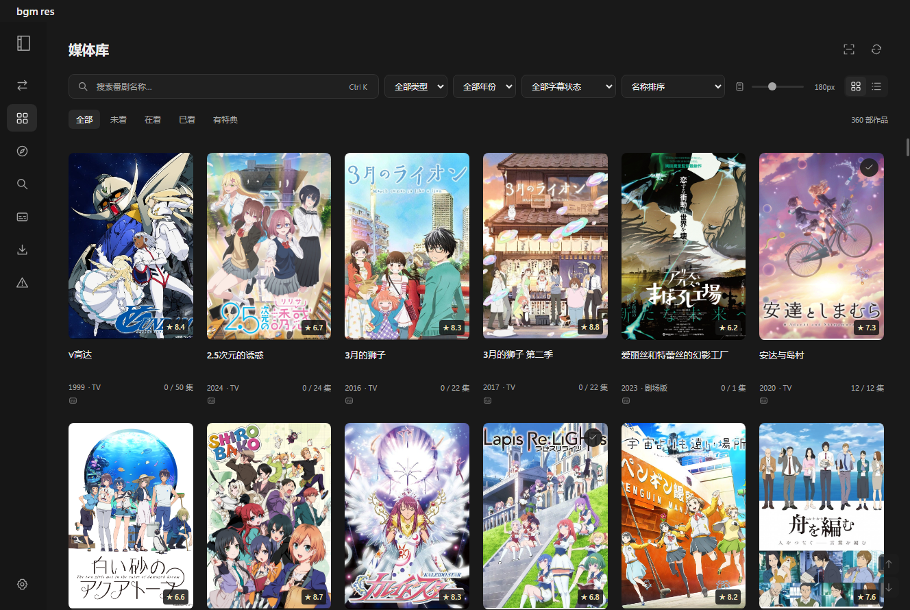
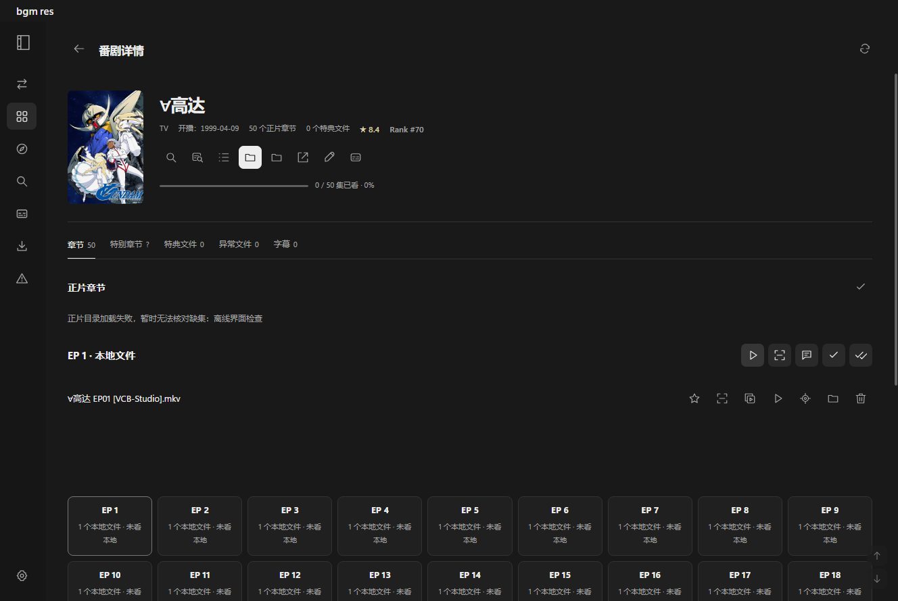
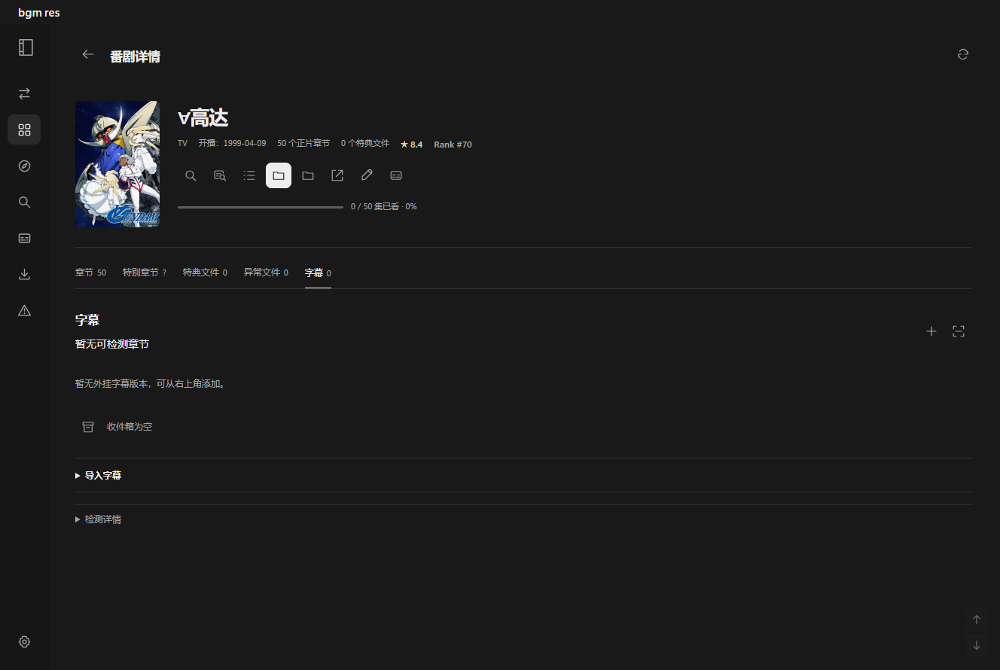
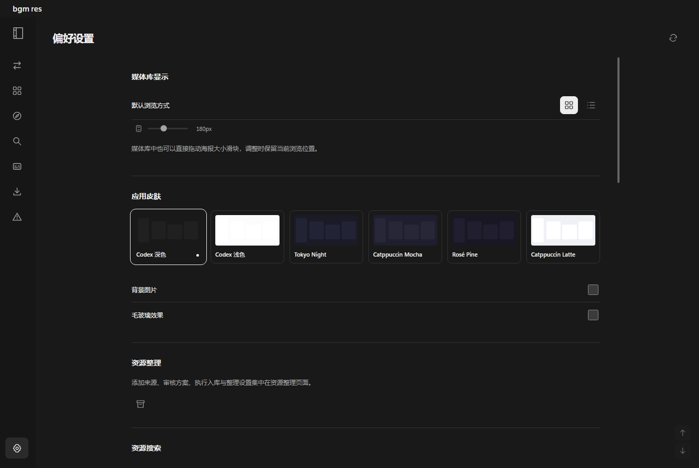

# bgm.res

基于 Bangumi 的 Windows 本地番剧管理器，将媒体库、观看进度、字幕和资源整理集中在一个桌面窗口中。

这是 [JimHans/bgm.res](https://github.com/JimHans/bgm.res) 的个人 fork。资源整理引擎已并入 `engine/`，后续在本仓库维护。当前版本使用 Electron / CommonJS 与 Python / FastAPI，媒体库沿用 NeDB，整理任务和方案使用 JSON。



## 能做什么

- **浏览媒体库**：海报与列表视图，按名称、类型、年份、观看状态和字幕状态筛选，按评分、开播时间或进度排序。海报使用虚拟网格，大小可调整。
- **发现作品**：浏览 Bangumi 排行榜、按名称或标签搜索，组合类型与年份等筛选；登录后查看个人收藏，筛出未入库或未收藏的作品。
- **搜索与下载资源**：聚合动漫花园、蜜柑、AniBT、Nyaa、Knaben 等来源，合并重复发布、预览种子文件，支持关键词高亮与 SeaDex 标记；交给 qBittorrent 下载后跟踪进度并生成待审核方案。
- **查看与续看**：作品详情、完整正片与特别章节目录、多版本文件、合集、特典和关联作品；通过系统播放器打开本地视频，记录看过、撤销或“看到这里”。
- **整理资源**：单文件、目录或整包来源识别，确认 Bangumi 归属，逐项审核文件到章节的映射、命名与输出位置，通过检查后执行入库。
- **管理字幕**：检测内封与外挂字幕，筛选缺失和待确认结果；从 Anime 字幕论坛与射手网搜索字幕，展开说明后下载，或选择本地字幕文件与目录，预览集号匹配、调整偏移和后缀后导入。
- **处理异常**：查看丢失、空文件等异常，清理登记记录；需要删除实际文件时显示确认并移入系统回收站。
- **调整外观**：默认中性石墨深色，支持浅色及其他配色、海报大小、背景与毛玻璃偏好，选择在本机保存。

## 新版界面

以下截图于 2026 年 11 月 9 日使用当前代码重新生成，采用隔离只读环境；截图环境不执行媒体整理或删除。

### 作品详情



### 字幕管理



侧栏提供独立的“字幕搜索”页，支持搜索后直接下载；也可从作品详情的“找字幕”进入，带上目标作品与名称。在同一个搜索框输入作品名，勾选一个或多个来源后提交。每个选中来源有自己的结果标签、分页和详情。搜索结果显示标题和摘要，点击后进入精简详情，只显示字幕包、说明、时间和发帖人；论坛无字幕附件的楼层自动隐藏，详情楼层也可分页。返回结果恢复原页与滚动位置。下载解压后，作品入口提供“识别并预览”，自动识别集数并回到该作品的字幕页核对，确认后才执行字幕命名与导入；原字幕页保留检测和本地文件导入。

射手网需要在“偏好设置 → 字幕服务”填写个人 Token（注册后从 [assrt 用户面板](https://assrt.net/) 获取）。配置后可返回字幕搜索，保留原查询、结果和目标作品。Token 使用系统加密保存在本机；系统加密不可用时仅保留在内存。请求共用队列并缓存五分钟，额度不足时独立等待、最多自动重试两次，也可取消或手动重试，不影响论坛搜索。

下载到应用用户数据下独立的 `subtitle-downloads` 目录，ZIP/7z/RAR 自动解压；确认前不会写入视频目录。字体等配套文件保留在下载目录。RAR 使用 Windows 自带的 `tar`（其他系统需要 `bsdtar`）；加密、分卷、系统工具不支持或解压失败时保留原包供手动处理。下载项超过 100 MiB、解压总量超过 512 MiB 或包含不安全路径时会停止处理。论坛需要登录或验证的资源可打开原网页下载，再使用本地导入。

### 偏好设置



## 准备与启动

当前仓库提供源码，没有附带安装包、Electron 便携运行时、播放器或用户数据。下面的准备方式适用于 Windows，并需要已有官方便携版运行时。

1. 安装 Python（依赖声明为 3.9 以上，本地已在 3.14 验证）及 Node.js。
2. 在仓库根目录准备 Python 环境：

   ```powershell
   python -m venv engine/.venv
   engine/.venv/Scripts/python.exe -m pip install -r engine/requirements.txt
   ```

3. 从已有官方便携版提取 Electron 运行时和 Node 依赖：

   ```powershell
   python manager/prepare-linked.py
   ```

   默认来源是 `%LOCALAPPDATA%\Programs\bgm.res-trial\app\win-unpacked`。其他安装位置可先设置：

   ```powershell
   $env:BGM_RUNTIME_SOURCE = 'D:\Apps\bgm.res\win-unpacked'
   python manager/prepare-linked.py
   ```

4. 双击根目录的 `启动 bgm.res.vbs`，或准备脚本生成的 `启动 bgm.res.cmd`。重复启动会聚焦已有窗口。

准备脚本将运行时放入 `.linked-desktop/`，依赖放入 `node_modules/`，不覆盖原安装。已有完整 npm 依赖与 Electron 开发环境时也可运行 `npm start`；沿用已有数据时应通过上述启动器进入。

## 整理一部作品

1. 在侧栏打开“资源整理”，选择来源文件或目录，启动识别。
2. 核对 Bangumi 条目；存在歧义时手动选择候选或填写 ID。整包可对应多个条目。
3. 打开待审核方案，检查每个文件的作品、资源类型、章节、版本与目标名称。可标记跳过，或将多集单文件设为“合集（正篇）”。
4. 确认正确映射，解决目标冲突、源文件丢失等问题，再更新检查。修改决定会使检查失效。
5. 检查通过后执行入库，完成后自动更新媒体库。

识别只生成方案。AI 辅助也需要手动发起，不会直接执行文件操作。可在整理设置中选择 GLM 或 DeepSeek 并填写对应密钥；请求发送相对文件名与候选章节，不上传视频。是否可用、赠送额度及实际费用取决于所配置服务。

后台任务可在离开页面后继续，关闭所有桌面窗口后，已排队和运行中的任务完成才退出后台。断电后的内存队列恢复尚未实现；任务记录与方案会保存在磁盘。

## 字幕与观看

作品详情的“字幕”页默认读取缓存，点击“检测本剧字幕”主动更新。可按状态或文件名筛选，展开查看轨道与路径。外挂导入需要作品已有整理记录；选择来源并生成匹配预览后，核对目标视频再提交。来源或偏移变化后需要重新预览，部分成功时仅保留未完成项。

正片和特别章节按 Bangumi 章节 ID 管理。目录获取失败时保留本地卡片并提示无法核对，不用不完整目录推断缺集。播放通过系统关联播放器打开文件；合集覆盖多个章节，仍参与观看进度与字幕检测。

单集卡片与本地版本文件提供“鉴赏”，通过 CadensView 打开对应视频，已有鉴赏项目由 CadensView 恢复。可在“偏好设置 → 单集鉴赏”选择 `CadensView.exe`；初始路径为本机的 `F:\softwares\CadensView-0.1.0-win-x64\CadensView.exe`。同一次 bgm.res 运行期间，重复打开同一视频不会再启动一个鉴赏进程。

默认只自动做镜头检测，色彩分析改为手动触发：需要时在 CadensView 设置菜单选择“重新生成色彩缓存”。0.3.0 没有独立默认开关，因此启动与更新时对本地 `Main.qml` 应用适配，并保存 `.bgm-original` 原件；每次打开或切换项目，在项目重置完成后暂停自动色彩任务，不影响镜头检测或已有色彩缓存。已运行的窗口需重新打开后应用此默认值。

受管理的程序实体统一放在 `F:\softwares\CadensView\versions\`，每个版本目录内直接包含 `CadensView.exe`、`_internal` 与 `worker`。直接从实体目录启动，不使用目录链接，避免 Qt 和镜头分析子进程解析真实路径后再次触发 Windows 路径长度限制。鉴赏项目仍由 CadensView 保存在原用户数据位置。

默认每天首次鉴赏时在后台检查 GitHub 正式发布，失败不影响打开视频；也可关闭自动检查或手动检查。发现新版后在设置页点击“下载更新”：下载 Windows x64 便携包，有官方 SHA-256 时校验摘要，并验证解压路径、版本和运行环境。新版保存在 `F:\softwares\CadensView\versions\`，滚动保留当前版和上一版，切换成功后自动删除更早的受管理版本。CadensView 运行时先保存待切换版本，此时暂时允许额外保留一个候选版本，全部鉴赏进程退出后自动切换并清理；可在设置页切回旧版。应用启动及空闲时也会重试清理。手动安装的外部目录、用户项目和非受管理目录不参与清理。回退仅切换程序，不能撤销新版对项目格式的修改，升级兼容性以 CadensView 为准。

## 数据与备份

- 默认桌面数据目录为 `%APPDATA%\bgm.res-linked`；`MediaData.db` 保存媒体库，`rename/` 保存整理配置、任务、记录、方案及日志。
- 已有引擎存储指针时沿用其指向的目录。`engine/.bgm-storage.json` 属于本机配置，不提交到仓库；首次接管可能读取原独立项目的指针定位历史数据。
- 封面、字幕和时长检测缓存保存在桌面数据目录。外观与排序等界面偏好保存在 Electron 用户配置中。
- 备份前退出桌面并等待后台任务结束，再备份整个实际数据目录。媒体文件需独立备份。
- 历史媒体链接、源路径和恢复日志可能仍依赖旧项目目录；清理旧程序源码不等于可以删除这些数据与路径。

旧版独立 SQLite 收藏管理入口、原版多窗口页面和整理引擎 NiceGUI 网页界面已移除。当前唯一桌面界面为 `desktop.html`，整理后台入口为 `python -m src.desktop_service`（在 `engine/` 下运行，由桌面自动管理）。

## 发现

侧栏「发现」可按 Bangumi 总排名、播出日期、动画形式和年月浏览，也可搜索动画名，或勾选「只看未入库」。游客能浏览公开榜单。在「登录 Bangumi」输入个人访问令牌（bgm_token）后，榜单和名称搜索按当前账号权限加载。「我的收藏」需登录，可切换想看、在看、搁置、抛弃和看过。令牌经 Electron safeStorage 加密保存在本机，退出登录会清除凭据。

排行榜搜索框左侧可切换「名称」或「标签」。标签搜索调用 Bangumi API，默认按匹配度排序，也可切换到收藏人数、排名或评分。多个标签用逗号分隔，结果须同时匹配。可继续组合筛选来源、类型、地区和受众。勾选「只看未收藏」会排除当前账号全部五种状态的动画，「刷新列表」会清除发现页快照并重新读取。应用空闲时预读榜单首页和当前账号的收藏，快照可复用十分钟。列表会预取下一页。已入库作品的片名和收录状态可打开媒体库详情，旁边的 Bangumi 链接可打开原站；未入库作品的片名直接打开原站。排行榜的排序与筛选集中在可收起的「筛选与排序」面板。

点击作品的「找资源」会预填片名，仍需手动提交搜索并选择发布。可用「返回发现」回到原浏览位置。下载进度、识别和入库审核沿用「下载任务」的现有流程。

发现页的「已收录 22/24 话」只计算正片，特别章节不参与计数与总数。已入库作品会复用章节目录缓存核对类型、总数与本地可用文件，同一章节的多个版本只计一次；目录暂不可用时按本地已登记的正片数量显示。

## 资源搜索

本地番剧详情页的「整理记录」可跳到资源整理任务列表，优先按 Bangumi 条目 ID 精确定位，同时包含多条目任务及本地文件已关联的任务；没有条目 ID 时按番名搜索。入口会重置任务状态筛选和页码，编辑搜索框可继续搜索其他记录。

搜索结果用琥珀色高亮关注的组名／关键词。「编辑高亮名单」展示完整名单（默认含 ReinForce），可直接添加或删除任意默认项及别名，每行一个或用逗号分隔，保存后在本机保留。清空并保存会关闭关键词高亮，「恢复默认名单」恢复内置名单。旧版追加的自定义关键词会随默认名单迁移，保存完整名单后以新名单为准。

SeaDex 使用公开 API 按种子 info hash 精确查询，异步标注独立的绿色「SeaDex Best」或蓝色「SeaDex Alt」，不凭组名或标题推断。点击标记打开对应条目，悬停查看标签和备注。结果未命中只表示此 hash 未列入，缺少 hash 的结果无法核对；网络失败可重试，不影响资源搜索。查询在主进程按批次执行，成功命中与未命中均在内存缓存一小时，失败不缓存。

可使用「只看高亮」筛选名单命中的结果，或开启「只看 SeaDex」仅显示 Best 或 Alt；两个筛选互斥，开启一个会关闭另一个，再次点击当前筛选或点击「清除筛选」恢复全部结果。筛选作用于已获取的全部结果，期间暂停自动预取，可点击「加载更多结果继续筛选」获取后续批次。

侧栏的「资源搜索」支持按来源搜索，从番剧详情或发现页点击「找资源」默认预填原名，缺失时依次使用中文名、罗马音，也可手动切换名称。选中的来源并行返回，具有相同 info hash 的发布合并显示，各站名可以打开来源页面。点击结果标题可预览种子内的文件路径、数量和大小；仅有磁链时，通过本机 qBittorrent Web UI 获取元数据。使用行末的下载按钮交给 qBittorrent，复制按钮取得磁链。种子保存在当前用户的 `Downloads\Torrents` 目录，视频下载位置由 qBittorrent 管理。

点击侧栏的「下载任务」可查看从应用发起的下载。先在 qBittorrent「选项 → Web UI」启用 Web 用户界面，再到应用偏好设置的「qBittorrent 下载监控」测试连接。应用会读取本机常规安装的端口，支持手动填写本机地址和凭据。默认在勾选文件下载完成后后台生成待审核方案；关闭自动识别后，可在下载任务里手动开始识别。退出应用期间完成的下载会在下次启动时补查（需保留 qBit 中的种子记录）。「清除记录」只移除本应用的跟踪记录。

结果每页最多显示 50 条，可点击页码或输入已加载的页码跳转。尚未加载的页码不显示，后续通过预取或下一页加载。已显示页面的顺序和边界保持稳定，尚未分页的结果按发布时间从新到旧排序，各来源按余量分别预取。蜜柑历史搜索的完整网页结果在内存中缓存 3 分钟，期间的后续翻页直接读取缓存。整理任务、方案文件清单、字幕文件列表和导入预览也支持页码跳转。

默认搜索来源包括动漫花园、蜜柑计划、AniBT、Nyaa 和 Knaben。蜜柑优先访问原站 `https://mikanani.me`；搜索、历史翻页及种子请求失败或返回无效内容时，自动切换到 `https://mikan.sakuramoe.dev` 反代。详情链接使用取得搜索结果的站点。Knaben 通过公开 API 返回哈希和磁链，可直接参与跨站合并。EXT 默认关闭，可在「偏好设置 → 资源搜索」启用并预热。首次使用会下载并校验 Windows 版 FlareSolverr（约 361 MiB），安装到 `%LOCALAPPDATA%\bgm.res\runtime`。其余五个来源可独立使用。EXT 新会话可能需要等待站点验证。

## 开发与验证

```powershell
node --test manager/*.test.cjs
engine/.venv/Scripts/python.exe manager/test-engine.py
```

Python 测试使用临时配置和输出目录。隔离 Electron 交互回归入口为 `manager/partial-render.electron.cjs`，需以开发 Electron 运行，覆盖局部渲染、输入保留、方案编辑及窄窗口布局。不要直接运行旧 `.desktop` 临时测试运行时。

目录分工：`index.js` 为桌面主进程，`desktop.html` 和 `js/library-desktop.cjs` 为界面，`js/organizer-desktop.cjs` 为整理审核界面，`engine/src/` 为整理引擎，`manager/` 为准备脚本、诊断工具和测试。详细行为见 [桌面版说明](manager/DESKTOP.md)，设计约定见 [DESIGN.md](DESIGN.md)。

## 来源与许可

本项目保留 [bgm.res](https://github.com/JimHans/bgm.res) 上游作者 JimHan 的版权与 [GPL-3.0 许可证](LICENSE)。合入的整理引擎保留 KimigaiiWuyi 的作者信息与 [原许可证](engine/LICENSE)。

感谢 [Bangumi API](https://github.com/bangumi/api)、[Electron](https://github.com/electron/electron)、[NeDB](https://github.com/louischatriot/nedb)、[mpv](https://github.com/mpv-player/mpv) 和 [FFmpeg](https://github.com/FFmpeg/FFmpeg) 等项目。各依赖及随运行时分发的组件适用其各自许可证。
